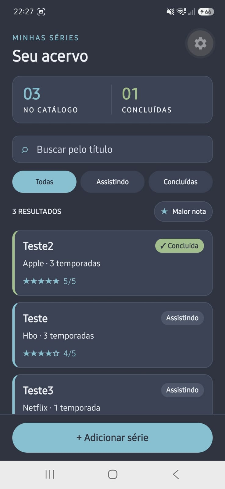
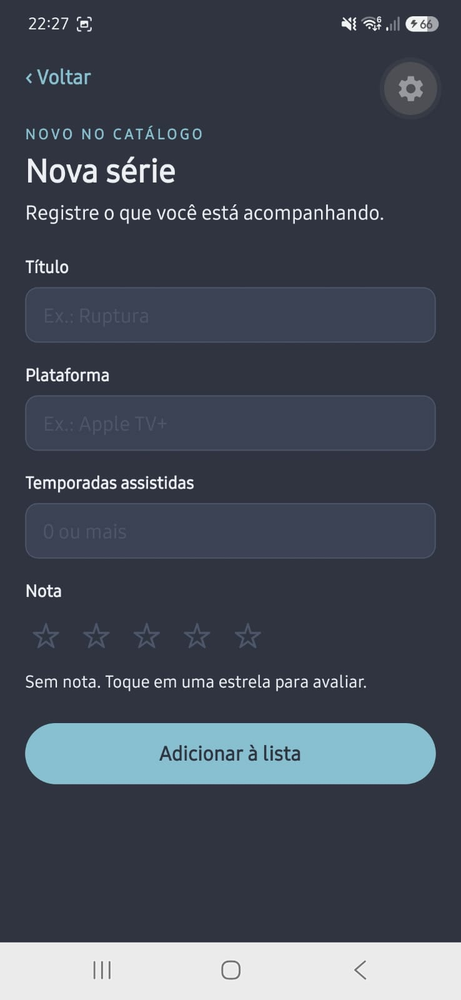
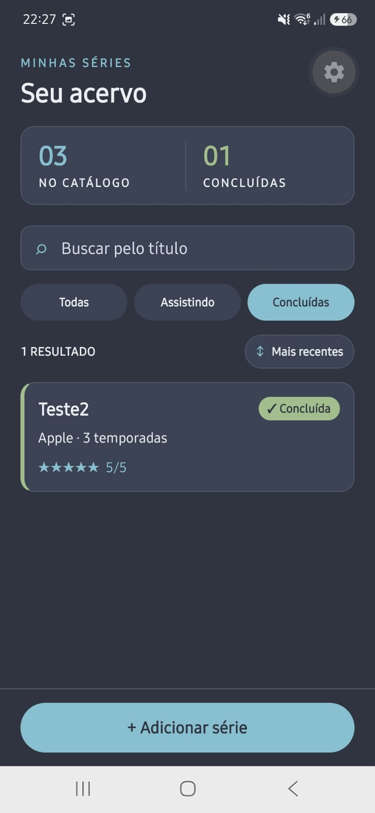
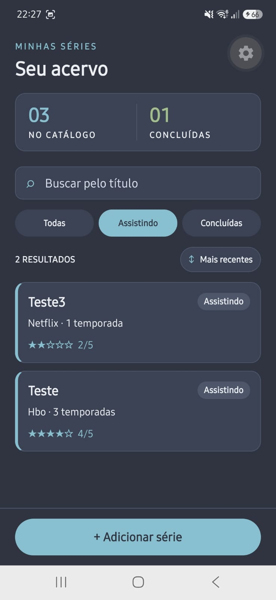
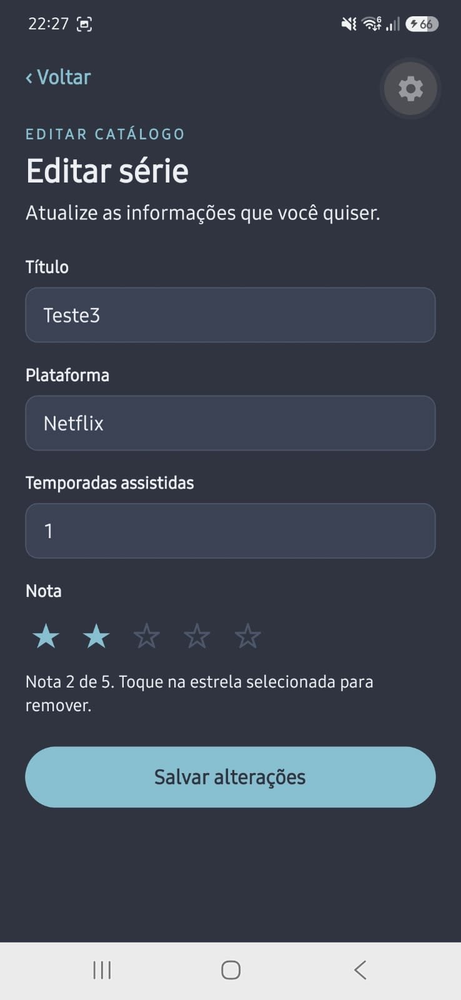
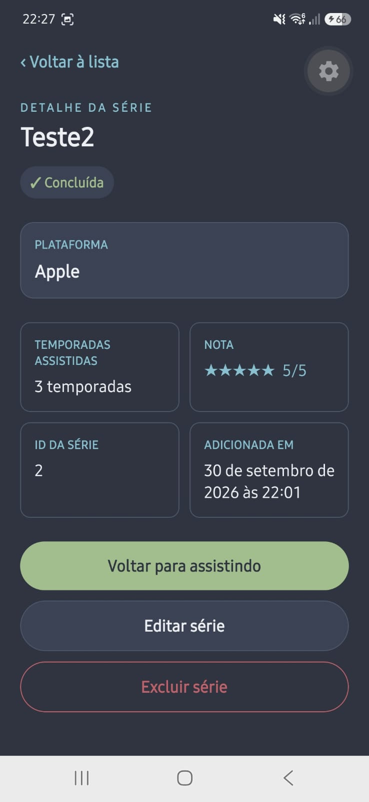
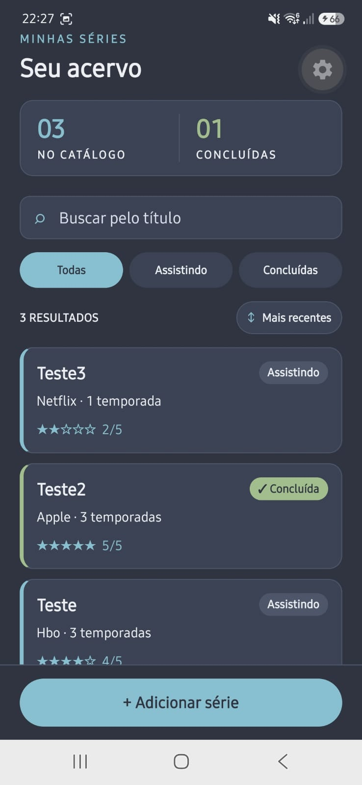
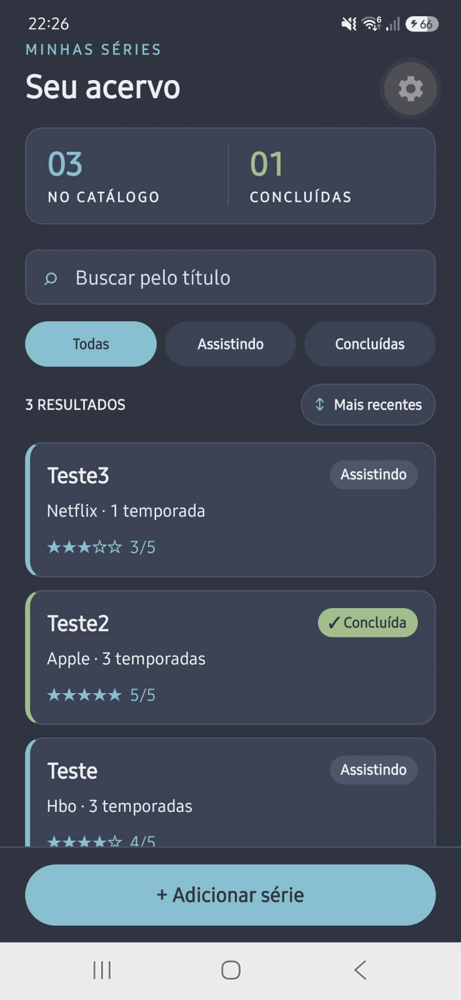

# Minhas Séries

Aplicativo mobile para registrar séries, acompanhar o que está em andamento e guardar os dados no SQLite. O projeto usa Expo Router, TypeScript e NativeWind, com visual baseado no tema Nord escuro.

## Como rodar

Requer Node.js compatível com Expo SDK 57 e um dispositivo ou emulador com Expo Go.

```bash
npm install --legacy-peer-deps
npx expo start
```

Use o QR code exibido pelo Expo para abrir o app. Se uma alteração de configuração visual não aparecer, reinicie com `npx expo start --clear`.

## Organização

- `src/app/`: rotas e telas do Expo Router.
- `src/types/serie.ts`: tipos de série e dos formulários.
- `src/database/database.ts`: conexão SQLite e criação da tabela.
- `src/database/serieRepository.ts`: consultas e alterações das séries.
- `DESIGN.md`: regras visuais baseadas no Nord Polar Night.

## Teste de persistência — Etapa 8

Cadastrei três séries, marquei Teste2 como concluída, editei a nota de Teste3 de 2/5 para 3/5 e validei os filtros e as ordenações. Depois fechei o app completamente e abri novamente. A última captura mostra as três séries, Teste2 concluída e a nota 3/5 de Teste3 preservadas.

### Evidências

#### 1. Lista ordenada por nota



A lista mostra três séries, uma concluída, e ordena os resultados por nota.

#### 2. Formulário de cadastro



O formulário de nova série começa vazio; a nota pode permanecer sem avaliação.

#### 3. Filtro de concluídas



Com “Concluídas” selecionado, Teste2 é o único resultado.

#### 4. Filtro de séries em andamento



Com “Assistindo” selecionado, aparecem Teste3 e Teste.

#### 5. Formulário de edição



Ao editar Teste3, o formulário carrega os valores salvos e mostra a nota anterior de 2/5.

#### 6. Detalhe de uma série concluída



O detalhe apresenta os dados de Teste2 e as ações para alterar o status, editar ou excluir.

#### 7. Lista antes da alteração da nota



Na ordenação por inclusão recente, Teste3 aparece com a avaliação original de 2/5.

#### 8. Lista após edição e reabertura do app



Após salvar a nota 3/5 e reabrir o app, a alteração continua no catálogo junto aos demais registros.

## Diário do copiloto

### Registro 1 — Etapa 2

**Contexto:** no cadastro, a avaliação é opcional. Se eu não selecionar nenhuma estrela, o app ainda precisa representar esse estado ao salvar a série.

**O que eu pedi:** decidir como enviar uma série sem avaliação: omitir o campo `nota` ou incluir um valor explícito.

**O que a IA sugeriu (resumo):** enviar `nota: null`, para o tipo e o valor salvo indicarem que a série não recebeu nota.

**O que eu fiz:** aceitei enviar `null` porque quero deixar claro que não coloquei uma nota na série. Assim, a ausência de avaliação é um estado previsto no cadastro, em vez de depender da omissão do campo.

**Como ficou no projeto:** `CreateSerieInput.nota` aceita `number | null`, e o formulário pode salvar sem uma avaliação selecionada.

### Registro 2 — Etapa 2

**Contexto:** ao editar uma série, o formulário carrega todos os valores atuais, mas normalmente só alguns deles precisam mudar.

**O que eu pedi:** decidir se o salvamento deveria enviar todos os campos editáveis ou somente aqueles que foram alterados.

**O que a IA sugeriu (resumo):** enviar sempre todos os campos, tratando o formulário como uma atualização completa.

**O que eu fiz:** rejeitei essa sugestão e escolhi enviar apenas os campos alterados. Isso reduz o risco de sobrescrever valores sem querer. Também permite detectar quando nenhum campo mudou e perguntar se eu realmente quero sair sem alterar a série.

**Como ficou no projeto:** `UpdateSerieInput` tem propriedades opcionais. O formulário compara os valores editados com os originais; se não encontra diferenças, mostra “Nenhuma alteração” e oferece continuar editando ou voltar à lista, sem gravar uma atualização.

### Registro 3 — Etapa 3

**Contexto:** a tabela guarda temporadas, nota e estado de conclusão. Esses valores têm limites definidos pelo funcionamento do app.

**O que eu pedi:** decidir se as regras de validade ficariam somente no código do aplicativo ou também seriam impostas pelo SQLite.

**O que a IA sugeriu (resumo):** adicionar restrições `CHECK` para temporadas não negativas, nota nula ou entre 1 e 5, e conclusão igual a 0 ou 1; usar 0 como valor padrão para uma série nova.

**O que eu fiz:** aceitei os `CHECK` porque quero impedir que dados inválidos sejam salvos. Também deixei claro que `concluida` deve ser um inteiro, sem usar `boolean`.

**Como ficou no projeto:** o banco exige temporadas maiores ou iguais a zero, aceita nota nula ou de 1 a 5 e restringe `concluida` aos inteiros 0 e 1, com padrão 0. Dessa forma, o próprio SQLite aplica essas regras ao gravar os dados.

### Registro 4 — Etapa 4

**Contexto:** uma tela pode tentar agir sobre uma série que já foi excluída ou cujo ID não corresponde a nenhum registro.

**O que eu pedi:** decidir o que o repositório deveria fazer se uma edição, mudança de status ou exclusão não encontrasse a série.

**O que a IA sugeriu (resumo):** lançar um erro explícito em vez de encerrar a operação silenciosamente.

**O que eu fiz:** aceitei essa opção porque quero que a tela possa tratar o caso e mostrar uma mensagem clara. Se o repositório ignorasse a operação, a interface poderia não explicar por que nada aconteceu.

**Como ficou no projeto:** edição, conclusão e exclusão verificam se o banco alterou uma linha. Se não houver registro correspondente, o repositório lança `Série não encontrada.`, que a interface pode capturar e apresentar à pessoa.

### Registro 5 — Etapa 5

**Contexto:** a lista continua na pilha de navegação enquanto o formulário ou o detalhe está aberto. Ao voltar, ela pode continuar montada com os dados que carregou antes.

**O que eu pedi:** fazer a lista atualizar quando eu retornasse de outra tela, para ela não exibir dados desatualizados.

**O que a IA sugeriu (resumo):** usar `useFocusEffect` para recarregar os dados sempre que a lista voltasse ao foco. Um `useEffect` com dependências vazias executaria apenas na montagem inicial; envolver a função em `useCallback` evita recriá-la a cada renderização.

**O que eu fiz:** aceitei essa solução porque quero evitar que a lista mostre informações antigas depois de uma edição, exclusão ou mudança de status. O recarregamento ao voltar mantém o catálogo atualizado sem exigir que eu saia e abra a tela novamente.

**Como ficou no projeto:** a tela da lista usa `useFocusEffect` com `useCallback` para buscar as séries e o resumo do catálogo quando recebe foco.
